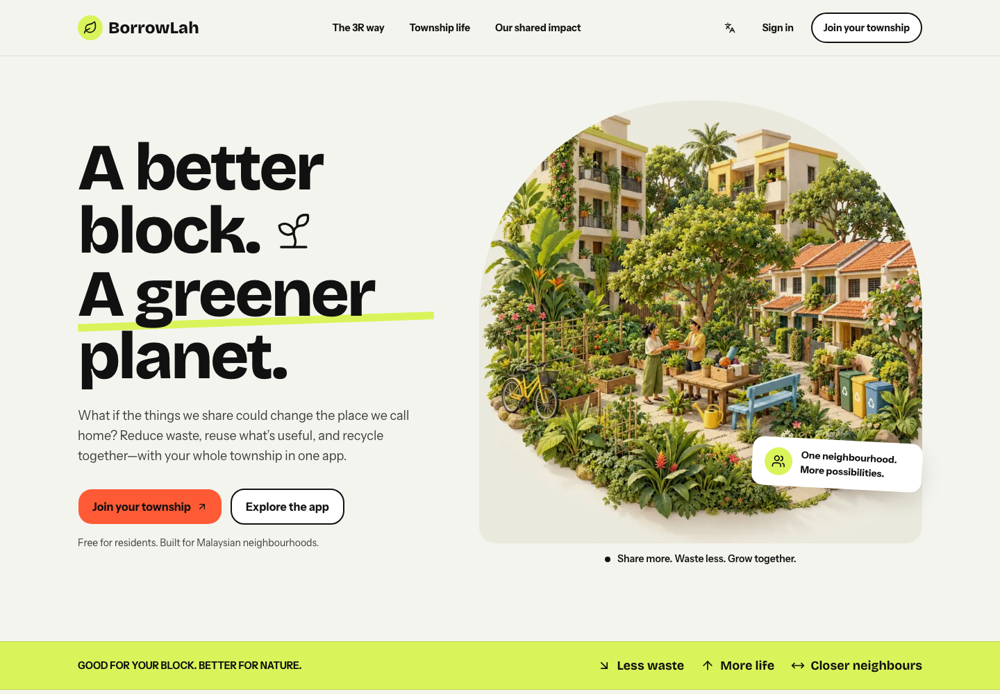
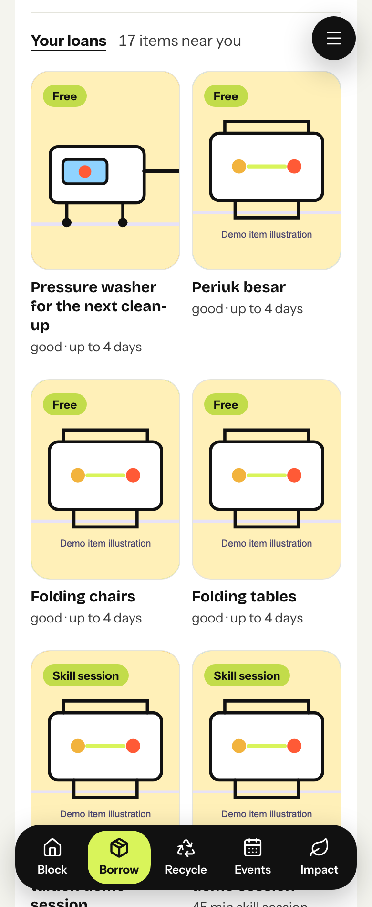
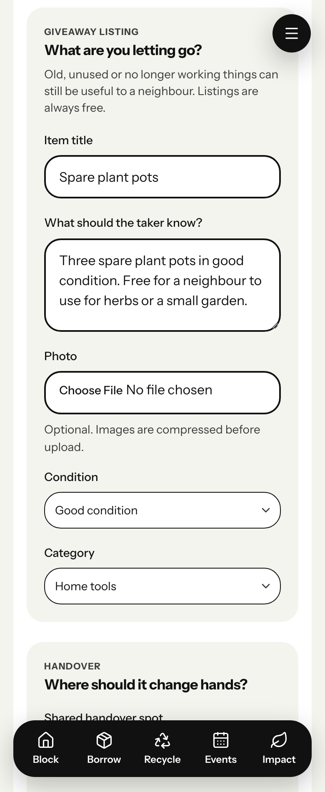
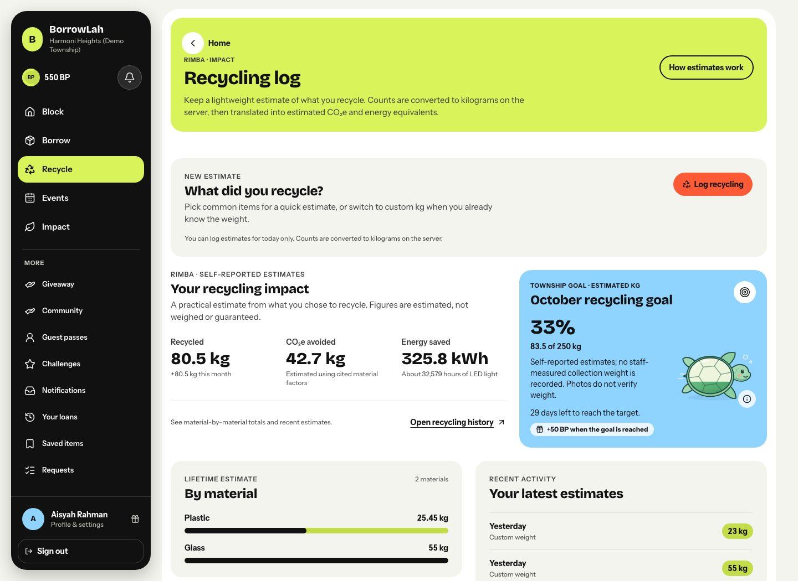
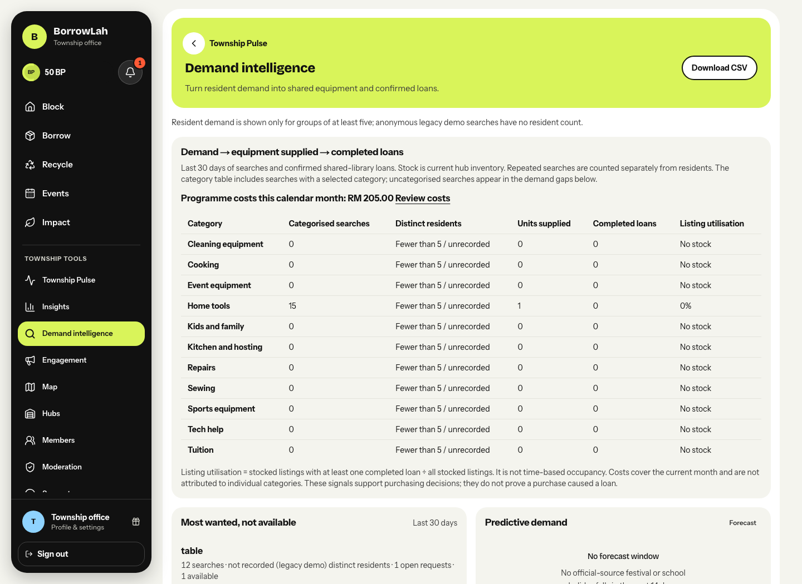
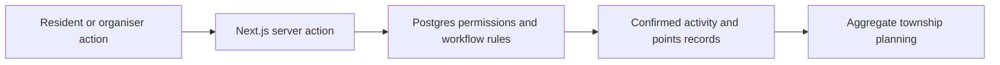

# BorrowLah

**Borrow before buying. Pass it on before throwing it away. Recycle together.**

BorrowLah helps Malaysian township residents practise **Reduce, Reuse and Recycle (3R)** through everyday actions: borrowing a tool, giving an unused item a second home, or logging recycling. BetterPoints and badges recognise participation, while the township office can use aggregate activity to plan shared resources.

**Prototype status:** demonstrated and tested locally with fictional demo data. Hosted deployment, physical-device rehearsal and a real-resident pilot remain pending in the project record. This is a working prototype, not evidence of measured environmental outcomes.

[The 3R experience](#the-3r-experience) · [Judge walkthrough](#judge-walkthrough) · [Impact and evidence](#impact-and-evidence) · [Run locally](#run-locally)



*The public landing page introduces the purpose: make useful sharing and recycling part of township life.*

## The problem we address

A resident may need a pressure washer for one afternoon, have spare plant pots someone else could use, or want to know how their recycling contributes to a shared goal. These are small, practical opportunities to use what the community already has.

BorrowLah brings those actions into one township app. The aim is to make participation easier to start, clearer to complete, and more useful for the people managing the township.

## The 3R experience

| Principle | What a resident can do | What the prototype records |
| --- | --- | --- |
| **Reduce** | Borrow an occasionally needed item instead of immediately buying one. | Requests, owner approval, two-sided handover and return confirmation. Purchase avoidance is a separate self-reported answer. |
| **Reuse** | Give away something unused, worn or useful for repair or parts. | Free listings, claims and two-sided collection confirmation. A giveaway transfers ownership; a loan expects a return. |
| **Recycle** | Log material counts or a known weight and follow the township recycling goal. | Self-reported recycling estimates, approximate material weight, and CO₂e/energy equivalents where documented factors are available. |

### Reduce and reuse: keep useful things in circulation

<table>
  <tr>
    <th>Reduce — borrow what you need</th>
    <th>Reuse — give something a second home</th>
  </tr>
  <tr>
    <td></td>
    <td></td>
  </tr>
</table>

**Reduce:** residents can browse township items, check their condition and loan limits, then request available dates. A request still needs the owner's approval.

**Reuse:** a resident can offer spare plant pots, explain their condition and arrange collection in a shared space. The screenshot shows an **unpublished example draft**, not an available listing or a completed giveaway.

### Recycle: connect a small action to a shared goal



Residents can see their estimated material totals alongside a shared township target. The turtle makes campaign progress easy to follow; it represents progress towards the recycling goal, not a measured benefit to wildlife.

The displayed kilograms, CO₂e and energy figures are **self-reported or calculated estimates**. Photos do not independently verify weight. See [metric definitions and calculation limits](docs/METRICS.md).

*All screenshots were captured from the local app on 15 October 2026. People, catalogue items, rewards and totals belong to the fictional demo. [Screenshot notes](docs/screenshots/judges/README.md) explain the routes and capture states.*

## Judge walkthrough

Once the local app is running, open [BorrowLah](http://127.0.0.1:3000). The landing page provides demo sign-in buttons; no real resident account is needed.

| Demo role | What to inspect |
| --- | --- |
| **Aisyah · resident** | Borrow and Giveaway for Reduce/Reuse; Recycle for estimates and the shared goal; Impact for BetterPoints, badges and rewards. |
| **Raj · organiser** | Event check-in and the lender side of the borrowing journey. Use a separate browser session when comparing two participants. |
| **Township office · admin** | Township Pulse and Demand intelligence for aggregate participation, resource demand, supplied equipment and recorded use. |

For a focused review:

1. **Start with one need:** open a shared item such as the pressure washer and review its dates, condition and handover guidance.
2. **Close the borrowing loop:** use separate borrower/lender sessions to approve, confirm pickup and confirm the return. One person's confirmation alone does not complete the loan.
3. **Inspect recognition:** check the resulting BetterPoints activity. Open a badge to see its requirements and, when earned, its recorded date. Points depend on configured rules and caps, not simply opening the app.
4. **Connect to 3R:** inspect the giveaway flow and the recycling estimates and shared goal.
5. **Switch to the office:** review demand and completed loans, and explain what the data can and cannot support.

The [presentation script](docs/DEMO_SCRIPT.md) provides a borrowing-led, three-minute sequence with an event check-in and a network/camera fallback. Its time allocation is planned; a timed human rehearsal is still pending.

## Impact and evidence



The township office can compare demand, current shared-equipment stock, completed hub loans and recorded programme costs. This supports practical questions such as **“What equipment should we share, and is it being used?”** The screenshot includes zero-use and suppressed values because missing evidence should remain visible.

| Evidence | How judges should interpret it |
| --- | --- |
| Confirmed borrowing, giveaway handovers and organiser event check-ins | Activity recorded through the corresponding confirmation workflow. RSVP or a pending request is not a completed contribution. |
| Estimated purchases avoided | Based on the borrower's answer and an estimated item value. It is not a receipt, guaranteed cash saving or measured reduction in production. |
| Recycling weight, CO₂e and energy | Resident estimates and conversions using documented reference factors. They are not staff-weighed collections or independently measured environmental savings. |
| Township dashboards | Descriptive planning signals. They do not prove that the app caused an environmental or social improvement. |

The next step is a small, consented resident pilot to measure whether people list, borrow, return and participate again, alongside disputes and staff workload. [The pilot plan](docs/PILOT_PLAN.md) sets out the method; **no real pilot results have been collected**.

## What supports participation

- **Trust and handover:** township membership, trust requirements, item guides, shared-space meeting arrangements and two-sided confirmations. Deposits are arranged offline; BorrowLah does not process money.
- **Recognition:** BetterPoints, configurable badges and rewards connect participation to visible progress. New badge awards retain their earning rules so later edits do not rewrite the explanation.
- **Practical help:** photo-assisted listing drafts, an article-grounded Help chatbot and aggregate admin summaries. AI suggestions need review and do not approve bookings, move money or change points.
- **Township life:** events, volunteering, community requests and guest passes support everyday use beyond a single recycling campaign.
- **Privacy:** planning views use aggregates, with distinct-resident breakdowns suppressed below five. The office also has authorised operational access for membership, disputes and programme administration; raw points-ledger review is audit logged. [Access policy](docs/PRIVACY_AND_SAFETY.md).

## Build and validation

The app uses **Next.js 16, React 19, TypeScript, Tailwind CSS and shadcn/ui**, with **Supabase Auth, Postgres, row-level security and Storage**. Database functions enforce the important booking, confirmation and points rules.



Local verification covers the borrowing lifecycle, permissions, duplicate-award protection, recycling estimates, badge rules, responsive layouts and accessibility. [PROGRESS.md](PROGRESS.md) contains the dated results and their scope. Local checks do not establish cloud readiness, physical-device performance or resident-pilot outcomes.

## Run locally

### Reuse the existing demo

The existing local Supabase stack is named `SDPHackathon` and contains **Harmoni Heights (Demo Township)**. Keep Docker/OrbStack running, then start the stack and app from the repository root:

```bash
npm install
npx supabase start
npm run dev --workspace web
```

Use the existing `apps/web/.env.local` configuration. Open [the app](http://127.0.0.1:3000), [Supabase Studio](http://127.0.0.1:54323), or [the health check](http://127.0.0.1:3000/api/health). A healthy response has `ok: true`.

For a production-mode local demo, run `npm run build --workspace web`, then `npm run start --workspace web`.

**Starting the app does not require a reset.** `npm run demo:reset` replaces local demo data. Use it only when deliberately restoring the fictional baseline, never against a resident pilot.

<details>
<summary><strong>Fresh setup, configuration and developer checks</strong></summary>

Requirements: Node.js 20.9 or newer, npm and Docker/OrbStack. The Supabase CLI is available through `npx`.

For a **new local demo environment**, copy `.env.example` to `apps/web/.env.local` and fill the Supabase URL, publishable key, server secret and application secrets. Next.js runs from `apps/web`; the seed/reset scripts also read the repository-root `.env.local`. Keep those configurations consistent and never commit either file.

After configuring a new, empty local demo stack:

```bash
npx supabase db push --local
npm run seed
npx supabase gen types typescript --local > apps/web/types/database.ts
npm run dev --workspace web
```

The existing local stack records a guest-pass migration whose source file is absent from this checkout (`20261016050000_guest_pass_sharing`). This can block the normal migration push on that stack. Preserve its data and reconcile the missing migration source before further migration work; see the notes in [PROGRESS.md](PROGRESS.md).

AI is optional. `.env.example` documents the server-only provider, model, endpoint and key settings. Without a working provider, photo listing remains manual, Help uses articles, and admin summaries use deterministic text. Enable only the feature flags needed for the demo.

Routine code checks:

```bash
npm run lint
npm run typecheck
npm test
npm run build
```

Database and browser tests should run only against fictional demo data. `npm run test:db` resets the local demo, and the default browser setup also resets it. To reuse existing demo data for browser checks, use `E2E_SKIP_RESET=true npm run test:e2e`. See [setup and deployment notes](docs/SETUP.md) for the full workflow.

</details>

## Remaining todos

The remaining work is deployment and field validation: prepare a hosted demo if needed, rehearse on real devices, time the presentation, and run a separate consented resident pilot. Local implementation and automated checks do not complete these steps.

<details>
<summary><strong>Deployment, rehearsal and pilot checklist</strong></summary>

### Optional cloud preview

- [ ] If remote hosting is needed, create a hosted Supabase demo project and authenticate the Supabase CLI. The existing local project does not need to be recreated for a local demo.
- [ ] Link the remote project, apply migrations and seed fictional demo data only.
- [ ] Authenticate Vercel and import the repository with root directory `apps/web` and access to the shared workspace packages.
- [ ] Set Preview environment variables using remote Supabase values and separate signing/cron secrets. Keep secrets out of the repository.
- [ ] Deploy the preview, set its HTTPS application URL and configure Supabase auth callback URLs, then redeploy if needed.
- [ ] Verify the remote health endpoint, join, sign-out, complete borrowing loop, exactly-once points, organiser check-in and admin permissions.
- [ ] Record the preview URL and cloud test results in [the rehearsal record](docs/REHEARSAL.md).

Follow [the deployment runbook](docs/SETUP.md). No cloud preview is deployed yet.

### Demo rehearsal

- [ ] Test resident, organiser and admin journeys on an actual phone and laptop against the preview.
- [ ] Check camera permission, QR scanning, manual token entry, navigation and sign-out on those devices.
- [ ] Rehearse [the three-minute script](docs/DEMO_SCRIPT.md) aloud with the actual clicks and a stopwatch. Trim until it finishes within 3:00; the current 180-second allocation is not a measured spoken duration.
- [ ] Rehearse the network/camera fallback and record the actual durations and any issues in [the rehearsal record](docs/REHEARSAL.md).
- [ ] Restore the fictional demo data before presenting. Keep the presentation centred on borrowing, verified participation, BetterPoints and township outcomes.

### Small resident pilot

- [ ] Assign a township operator, support hours and a dispute contact; agree deposit, waiver and refund expectations.
- [ ] Set up a separate pilot environment with demo mode disabled. Never seed or reset the live pilot database.
- [ ] Publish the [privacy/access policy](docs/PRIVACY_AND_SAFETY.md), obtain consent and recruit 8–12 adult residents through the operator.
- [ ] Supply 3–5 low-risk shared items and observe residents listing, requesting, handing over and returning items themselves.
- [ ] Gather feedback on trust, deposits and disputes using [the pilot interview prompts](docs/PILOT_PLAN.md).
- [ ] Record assistance and staff minutes in [the observation sheet](docs/pilot-observations.csv), using participant codes rather than identifying details.
- [ ] Measure listing/borrowing activation, completion, on-time returns, repeat participation, disputes and staff workload; record programme costs and missing cost categories.
- [ ] Review results on days 7 and 14, report numerators/denominators and anonymised themes, and decide whether to extend the pilot. No real pilot feedback or outcomes have been collected yet.

### Optional follow-up

- [ ] Decide whether staff-recorded collection weights are needed. If added, keep measured collections separate from resident estimates, with staff attribution, evidence and correction history; do not combine the two totals.

</details>

## Further reading

| Document | Use it to review |
| --- | --- |
| [Demo script](docs/DEMO_SCRIPT.md) | The presentation sequence and fallback plan. |
| [Metric definitions](docs/METRICS.md) | What is counted, estimated or suppressed. |
| [Privacy and safety](docs/PRIVACY_AND_SAFETY.md) | Who can see which records and how operational access works. |
| [Pilot plan](docs/PILOT_PLAN.md) | How real use and staff workload would be evaluated. |
| [Progress and verification](PROGRESS.md) | Dated implementation and local validation evidence. |
| [Setup](docs/SETUP.md) · [Architecture](docs/ARCHITECTURE.md) | Developer setup, deployment and system design. |

The app includes an install-support service worker without general offline data caching. Offline handover-token queuing is a separate, limited workflow.
