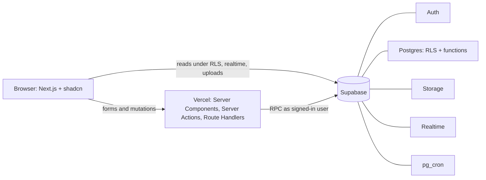
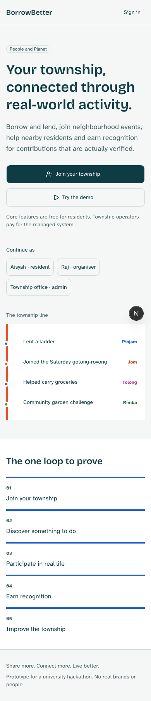
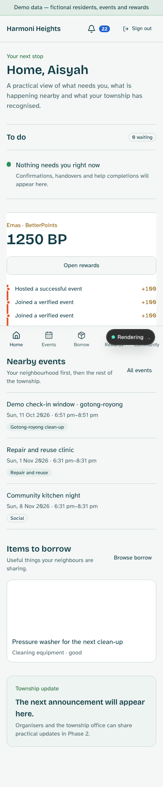
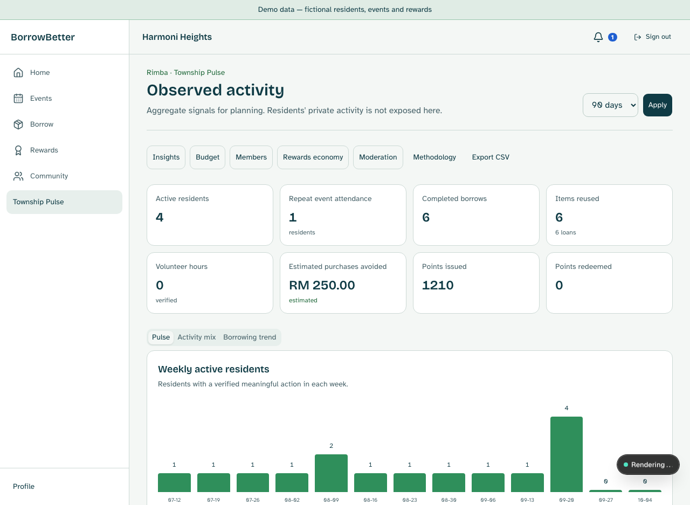

# BorrowBetter

**Share more. Connect more. Live better.**

BorrowBetter is a demo-ready community participation and sustainability system for Malaysian townships. Residents borrow and lend, join neighbourhood events, help one another and earn BetterPoints for verified real-world contributions. Township managers see aggregate impact, not private resident activity.

## Architecture



The integrity-critical writes are Postgres functions. The service-role key is restricted to server-only seeding, demo reset and cron code.

## Quick start

See [`docs/SETUP.md`](docs/SETUP.md) for the full fresh-setup runbook and human-only Supabase/Vercel steps.

```bash
npm install
npx supabase start
npx supabase db push
npm run types:gen
cp .env.example .env.local
npm run dev
```

Open `http://127.0.0.1:3000`. The health check is `/api/health`.

## Quality gates

```bash
npm run lint
npm run typecheck
npm test
npm run test:db
npm run build
npm run test:e2e
```

## Documentation

- [`docs/PLAN.md`](docs/PLAN.md) — phased build plan and acceptance criteria
- [`PROGRESS.md`](PROGRESS.md) — live checklist and verification log
- [`docs/DESIGN_PLAN.md`](docs/DESIGN_PLAN.md) — township-line design system
- [`docs/SETUP.md`](docs/SETUP.md) — local, cloud and human-only setup
- [`docs/DECISIONS.md`](docs/DECISIONS.md) — implementation choices
- [`docs/ARCHITECTURE.md`](docs/ARCHITECTURE.md) — system, data model, booking and points flow
- [`docs/METRICS.md`](docs/METRICS.md) — metric definitions and limitations
- [`docs/PRIVACY_AND_SAFETY.md`](docs/PRIVACY_AND_SAFETY.md) — privacy, safety and inclusion controls
- [`docs/PILOT_PLAN.md`](docs/PILOT_PLAN.md) — baseline/pilot comparison assumptions
- [`docs/DEMO_SCRIPT.md`](docs/DEMO_SCRIPT.md) — three-minute walkthrough

The prototype uses fictional demo residents, events, partners and rewards. Estimated impact figures are labelled estimated and should not be presented as guaranteed savings.

The app includes an install-support service worker without offline data caching.

## Screenshots




