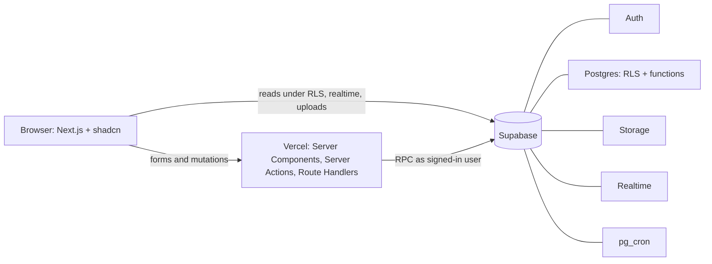

# BorrowLah

**Share more. Connect more. Live better.**

BorrowLah is a demo-ready community participation and sustainability system for Malaysian townships. Residents borrow and lend, join neighbourhood events, help one another and earn BetterPoints for verified real-world contributions. Township managers see aggregate impact and authorised operational records for their own township; raw points-ledger review is audit logged.

## Remaining todos

The local implementation is complete and the implementation goal was closed at the project owner's request on 14 October 2026. The following deployment and field-validation tasks remain as a handoff checklist; they have not been completed.

### Local demo (uses the existing Supabase project)

The existing `SDPHackathon` Supabase stack contains **Harmoni Heights (Demo Township)**. It is the database used by the local app and all local verification; a new Supabase project is not needed for this demo.

- App: [http://127.0.0.1:3000](http://127.0.0.1:3000)
- Supabase API: `http://127.0.0.1:54321`
- Supabase Studio: [http://127.0.0.1:54323](http://127.0.0.1:54323)

Keep Docker/OrbStack and the local Supabase services running. Start the app with:

```bash
npm run start --workspace web
```

If the production build is missing or code has changed, first run `npm run build --workspace web`. Use the landing page's resident, organiser and office demo sign-in buttons. Starting the app reuses existing data; no reset or reseed is required. `npm run demo:reset` is optional and replaces the local database, so use it only when deliberately restoring the fictional baseline.

Continue with the device rehearsal and resident pilot checklists below. The cloud steps are optional unless a remotely hosted preview is required; a hosted Vercel app cannot reach this computer's `127.0.0.1` database.

### Optional cloud preview

- [ ] If remote hosting is needed, create a hosted Supabase demo project and authenticate the Supabase CLI. The existing local project does not need to be recreated for a local demo.
- [ ] Link the remote project, apply migrations and seed fictional demo data only.
- [ ] Authenticate Vercel and import the repository with root directory `apps/web` and access to the shared workspace packages.
- [ ] Set Preview environment variables using remote Supabase values and separate signing/cron secrets. Keep secrets out of the repository.
- [ ] Deploy the preview, set its HTTPS application URL and configure Supabase auth callback URLs, then redeploy if needed.
- [ ] Verify the remote health endpoint, join, sign-out, complete borrowing loop, exactly-once points, organiser check-in and admin permissions.
- [ ] Record the preview URL and cloud test results in [the rehearsal record](docs/REHEARSAL.md).

Follow [the deployment runbook](docs/SETUP.md). No cloud preview is deployed yet.

### Demo rehearsal

- [ ] Test resident, organiser and admin journeys on an actual phone and laptop against the preview.
- [ ] Check camera permission, QR scanning, manual token entry, navigation and sign-out on those devices.
- [ ] Rehearse [the three-minute script](docs/DEMO_SCRIPT.md) aloud with the actual clicks and a stopwatch. Trim until it finishes within 3:00; the current 180-second allocation is not a measured spoken duration.
- [ ] Rehearse the network/camera fallback and record the actual durations and any issues in [the rehearsal record](docs/REHEARSAL.md).
- [ ] Restore the fictional demo data before presenting. Keep the presentation centred on borrowing, verified participation, BetterPoints and township outcomes.

### Small resident pilot

- [ ] Assign a township operator, support hours and a dispute contact; agree deposit, waiver and refund expectations.
- [ ] Set up a separate pilot environment with demo mode disabled. Never seed or reset the live pilot database.
- [ ] Publish the [privacy/access policy](docs/PRIVACY_AND_SAFETY.md), obtain consent and recruit 8–12 adult residents through the operator.
- [ ] Supply 3–5 low-risk shared items and observe residents listing, requesting, handing over and returning items themselves.
- [ ] Gather feedback on trust, deposits and disputes using [the pilot interview prompts](docs/PILOT_PLAN.md).
- [ ] Record assistance and staff minutes in [the observation sheet](docs/pilot-observations.csv), using participant codes rather than identifying details.
- [ ] Measure listing/borrowing activation, completion, on-time returns, repeat participation, disputes and staff workload; record programme costs and missing cost categories.
- [ ] Review results on days 7 and 14, report numerators/denominators and anonymised themes, and decide whether to extend the pilot. No real pilot feedback or outcomes have been collected yet.

### Optional follow-up

- [ ] Decide whether staff-recorded collection weights are needed. If added, keep measured collections separate from resident estimates, with staff attribution, evidence and correction history; do not combine the two totals.

Local validation completed: **83 unit/component tests, 219 database assertions and all 16 production browser scenarios verified**, including targeted reruns. Lint, TypeScript and the production build pass. See [PROGRESS.md](PROGRESS.md) for the verification record.

## Architecture



The integrity-critical writes are Postgres functions. The service-role key is restricted to server-only seeding, demo reset, cron code and authenticated self-account deletion.

## Quick start

See [`docs/SETUP.md`](docs/SETUP.md) for the full fresh-setup runbook and human-only Supabase/Vercel steps.

```bash
npm install
npx supabase start
npx supabase db push
npm run types:gen
cp .env.example .env.local
npm run dev
```

Open `http://127.0.0.1:3000`. The health check is `/api/health`.

## Quality gates

```bash
npm run lint
npm run typecheck
npm test
npm run test:db
npm run build
npm run test:e2e
```

## Documentation

- [`docs/PLAN.md`](docs/PLAN.md) — phased build plan and acceptance criteria
- [`PROGRESS.md`](PROGRESS.md) — live checklist and verification log
- [`docs/DESIGN_PLAN.md`](docs/DESIGN_PLAN.md) — township-line design system
- [`docs/SETUP.md`](docs/SETUP.md) — local, cloud and human-only setup
- [`docs/DECISIONS.md`](docs/DECISIONS.md) — implementation choices
- [`docs/ARCHITECTURE.md`](docs/ARCHITECTURE.md) — system, data model, booking and points flow
- [`docs/METRICS.md`](docs/METRICS.md) — metric definitions and limitations
- [`docs/PRIVACY_AND_SAFETY.md`](docs/PRIVACY_AND_SAFETY.md) — privacy, safety and inclusion controls
- [`docs/PILOT_PLAN.md`](docs/PILOT_PLAN.md) — baseline/pilot comparison assumptions
- [`docs/DEMO_SCRIPT.md`](docs/DEMO_SCRIPT.md) — three-minute walkthrough

The prototype uses fictional demo residents, events, partners and rewards. Estimated impact figures are labelled estimated and should not be presented as guaranteed savings.

The app includes an install-support service worker without offline data caching.

## Screenshots


