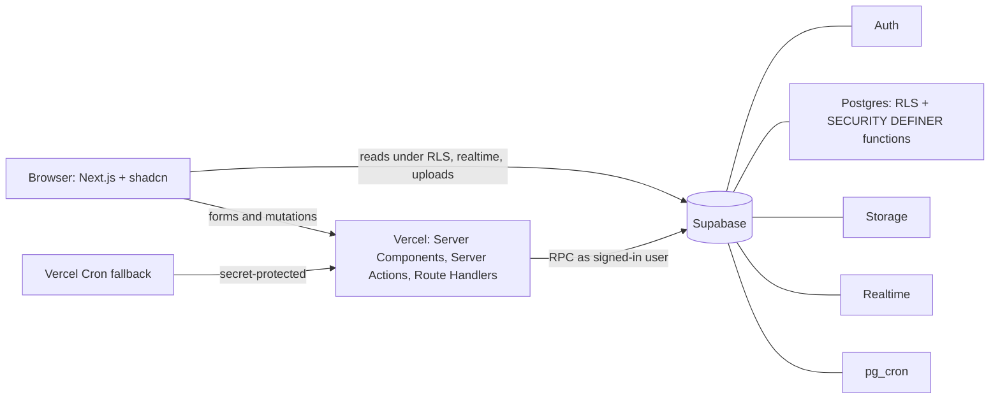

# Architecture

## System



## Data model summary

- Identity: `townships`, `neighbourhoods`, `facilities`, `profiles`, `township_members`, `audit_log`.
- Events: `event_categories`, `events`, `event_staff`, `event_rsvps`.
- Borrow/share: `item_categories`, `items`, `bookings`, `booking_messages`, `disputes`.
- Community: `announcements`, `help_requests`, `interest_groups`, `group_members`, `reports`, `blocks`.
- Gamification: `reward_rules`, `points_ledger`, `v_member_points`, `levels`, `badges`, `user_badges`, `challenges`, `challenge_progress`, `partners`, `rewards`, `redemptions`.
- Impact: `notifications`, `programme_costs`, `pilot_baselines`, `recycling_materials`, `recycling_units`, `recycling_logs`, `recycling_log_items`, `recycling_campaigns`.

## Booking state machine

```text
requested --approve--> approved --both confirm handover--> handed_over
requested/approved --cancel--> cancelled
handed_over --borrower marks returned--> handed_over (return marked)
handed_over --lender confirms return--> completed
handed_over/completed --open dispute--> disputed --admin resolve--> completed or closed
```

`transition_booking` is the only resident-facing way to change booking status. The exclusion constraint prevents overlapping approved/handed-over bookings.

## Points flow

```text
Verified event check-in / completed lend / help / challenge
  → SECURITY DEFINER award_points()
  → points_ledger append-only row
  → badges and challenge progress
  → notification and Rewards/Home route

Resident recycling estimate
  → SECURITY DEFINER log_recycling()
  → recycling_logs + recycling_log_items (self-reported kg and optional EXIF-stripped photos)
  → material factors convert to estimated CO₂e and kWh on read
  → active campaign refresh → idempotent recycling_goal_completed award (50 BP)
```

`points_ledger` has no update or delete grants for `authenticated`. Corrections use negative `reversal` rows and `audit_log`.

## Service-role usage

`apps/web/lib/supabase/admin.ts` is `server-only` and is reserved for seeding, demo reset and cron jobs. Resident-facing writes use the signed-in user and RPCs. Dashboard queries use aggregate RPCs such as `township_pulse`, `admin_insights`, `admin_budget` and `admin_rewards_economy`.
